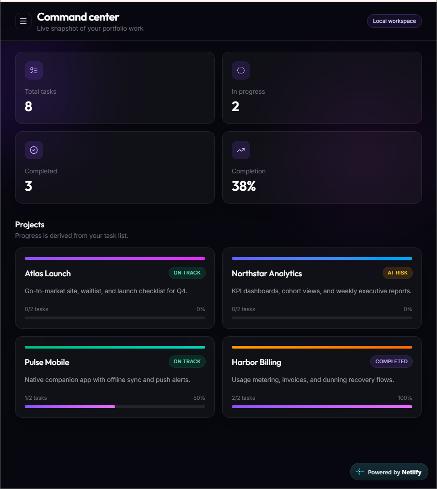
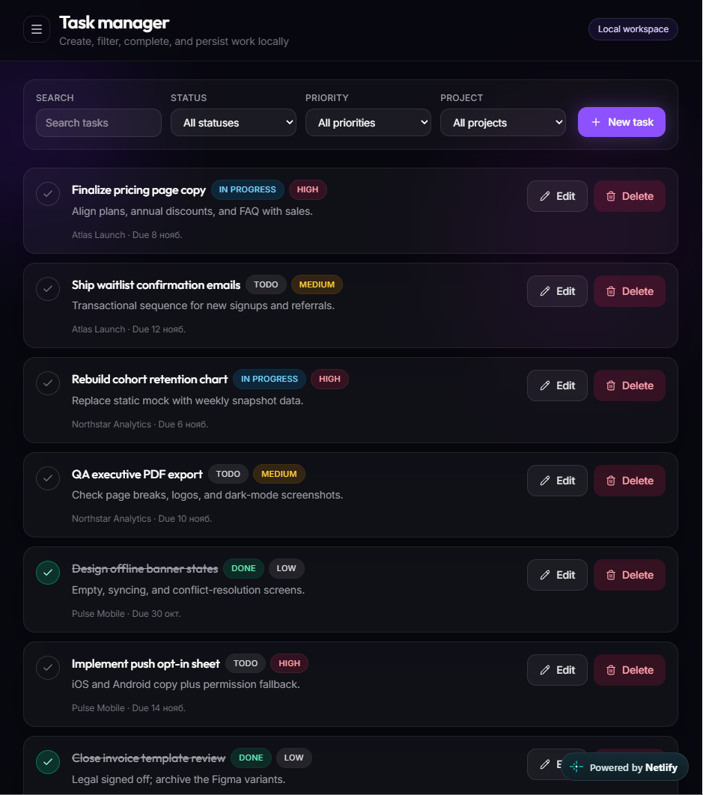
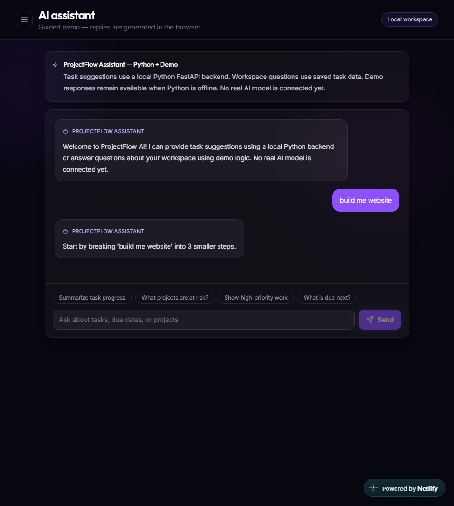

# ProjectFlow AI

A modern, responsive full-stack task management dashboard built with React, TypeScript, Tailwind CSS, and Python FastAPI.

ProjectFlow AI helps users organize tasks, track project progress, and receive simple task-planning suggestions through a Python-powered assistant.

## Live Demo

**[Launch ProjectFlow AI](https://projectflow-ai-dilnaz.netlify.app/)**

## Screenshots

### Dashboard


### Task Manager


### AI Assistant


## Features

- Create, edit, complete, and delete tasks
- Search and filter tasks by status, priority, and project
- Track project progress through an interactive dashboard
- Save workspace data locally using browser localStorage
- Responsive interface for desktop and mobile
- Python-powered assistant providing rule-based task suggestions
- Frontend-to-backend communication through a REST API

## Tech Stack

**Frontend**
- React
- TypeScript
- Tailwind CSS
- Vite

**Backend**
- Python
- FastAPI
- Uvicorn
- REST API

**Deployment**
- Netlify — frontend hosting
- Render — backend hosting
- GitHub — version control

## Architecture

```text
React + TypeScript
        |
        | HTTP requests
        v
Python FastAPI
        |
        v
Rule-based task suggestions
```

Task and project data are stored locally in the browser using localStorage.

## Run Locally

### 1. Clone the repository

```bash
git clone https://github.com/Dilnaz138/project-flow-pro.git
cd project-flow-pro
```

### 2. Start the frontend

```bash
npm install
npm run dev
```

Open `http://localhost:5173`.

### 3. Start the backend

Open a second terminal:

```bash
cd backend
python -m pip install -r requirements.txt
python -m uvicorn main:app --reload
```

The backend runs at `http://127.0.0.1:8000`.

API documentation: `http://127.0.0.1:8000/docs`

## Deployment

- **Frontend:** [Netlify](https://projectflow-ai-dilnaz.netlify.app/)
- **Backend:** [Render API documentation](https://projectflow-ai-backend.onrender.com/docs)

The backend may take additional time to respond after inactivity on Render's free hosting tier.

## Current Limitations

- The assistant uses rule-based Python logic rather than a generative AI model.
- Tasks are saved in browser localStorage rather than a cloud database.
- User accounts and authentication are not implemented.

## Future Improvements

- Integrate a real AI model for contextual task assistance
- Add a cloud database
- Implement user authentication
- Add automated tests
- Improve error handling and loading states

## Author

**GitHub:** [Dilnaz138](https://github.com/Dilnaz138)